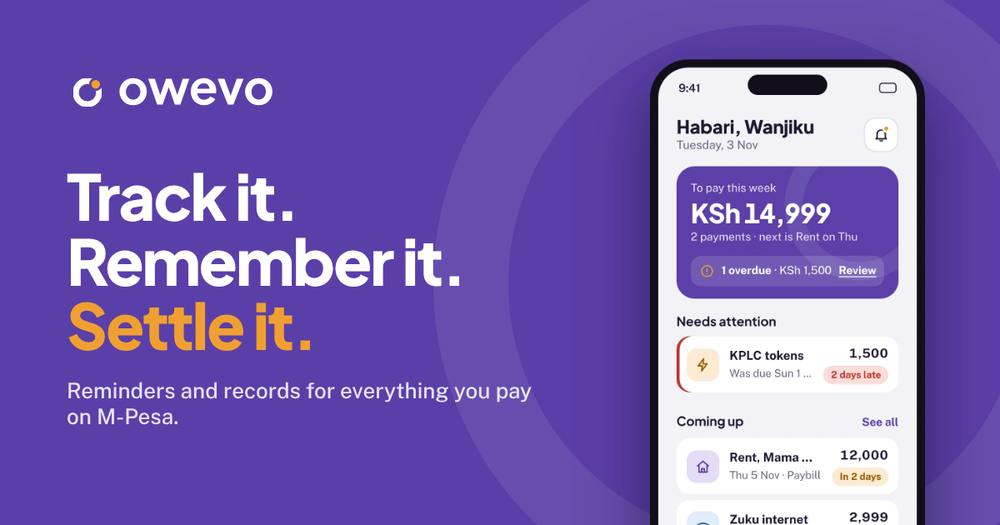
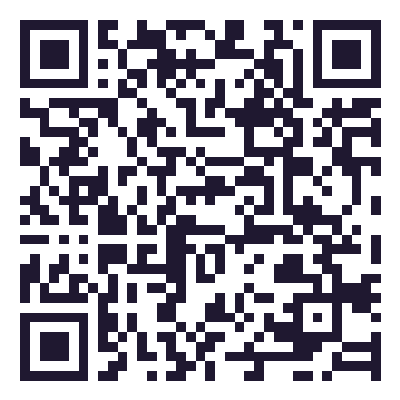

  

# Owevo for Android

Owevo reminds you before rent, KPLC, school fees and chama contributions are
due, and keeps a record of every payment when you paste the M-Pesa message.
Owevo never holds, sends or moves your money. You pay on M-Pesa as usual.

This repository only holds the Android app for download. It contains no source code.

## Download

**[⬇ Download Owevo for Android (APK)](https://github.com/ben397/owevo-releases/releases/download/android-latest/owevo.apk)**

This link always gets the newest version. You can also find it on the
[Releases page](https://github.com/ben397/owevo-releases/releases/latest).

On a computer? Scan the code with your phone's camera.

Owevo is free to start, and every new account gets 14 days of Owevo Plus.
The iPhone app is on the way.

## Installing

Owevo isn't on Google Play yet, so Android asks you to allow the download once.

1. **Download.** Tap the link above. Your browser saves `owevo.apk`.
2. **Open it.** Tap the download in your notifications or in the Files app.
3. **Allow this source.** If Android asks, tap **Settings** and turn on
   **Allow from this source** for your browser, then go back.
4. **Install and sign up.** Tap **Install**, open Owevo and enter your Kenyan phone number.

**Updating:** download the newest APK and install it. If Android says the app
can't be installed, uninstall the old Owevo first and then install. Your payments
are kept on your Owevo account, so log back in with your number and Owevo PIN.

## Staying safe

- Only download Owevo from this page or from [the Owevo website](https://owevo-website.onrender.com/download).
- Owevo will **never** ask for your M-Pesa PIN. You sign in with your own 4-digit Owevo PIN.
- When you paste an M-Pesa message, it is read on your phone. Your M-Pesa balance
  never leaves your phone.

## Help

- Website: [owevo-website.onrender.com](https://owevo-website.onrender.com)
- [Privacy Policy](https://owevo-website.onrender.com/privacy)
- [Terms of Service](https://owevo-website.onrender.com/terms)
- Support: [support@owevo.app](mailto:support@owevo.app). We answer within 7 days.

---

Each release is published automatically when the Owevo app is updated.
M-Pesa is a trademark of Safaricom PLC.
